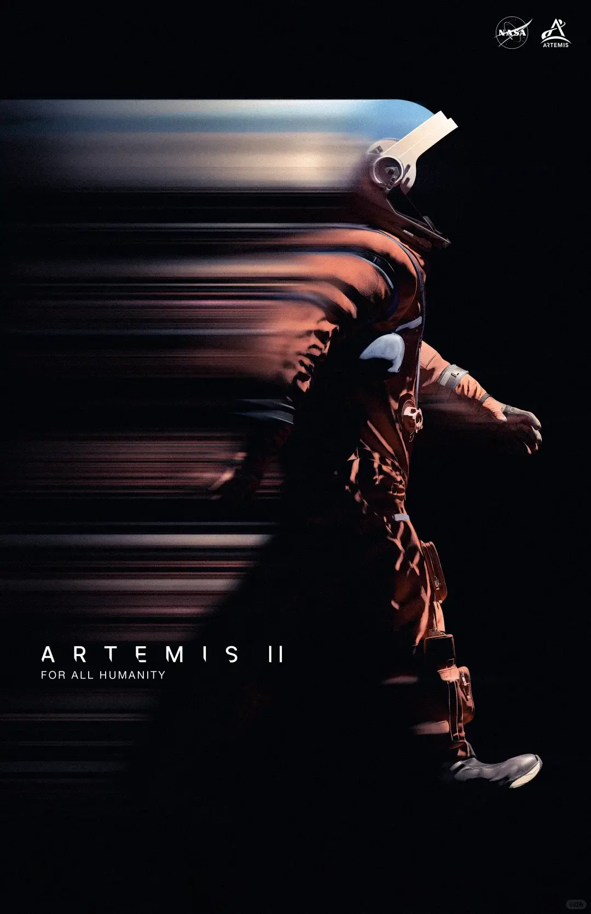
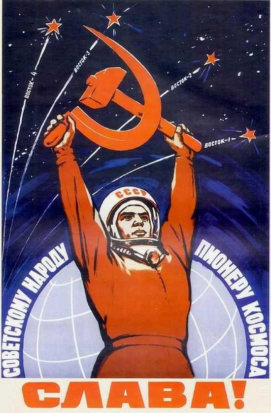

看了一点点点点海报，对设计海报有一点点点点思考，暂且记录一下。

从解构主义的视角来看（暂且这么称呼），海报的设计可以分为几个部分。例如，色调是否统一，主体是否突出，信息是否明确等等。
从我自己的角度认为，这些评价标准足以辅导和评价一个海报在视觉效果上是否合格，以及从功能性上来说是否能够达成其所想要达到的内容。然而这样似乎并不足够构成一幅真正的海报。

我在查看很多海报的途中，结合自己以前看过的海报。对我比较有触动的，我真正觉得优秀的海报主要来源于两类。第一类是NASA的，特别是最近的artemis ii任务的海报，以及类似于火星探测器的几个海报。第二类是前苏联的一些海报，其中特别是关于工业演进和航天的几个海报。

这两者