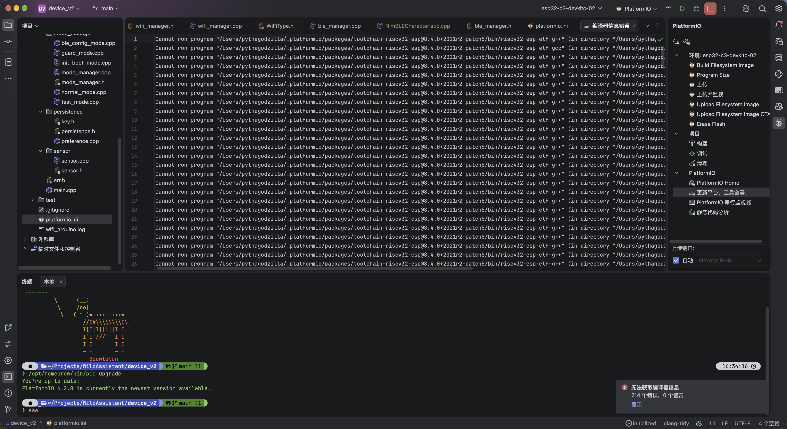
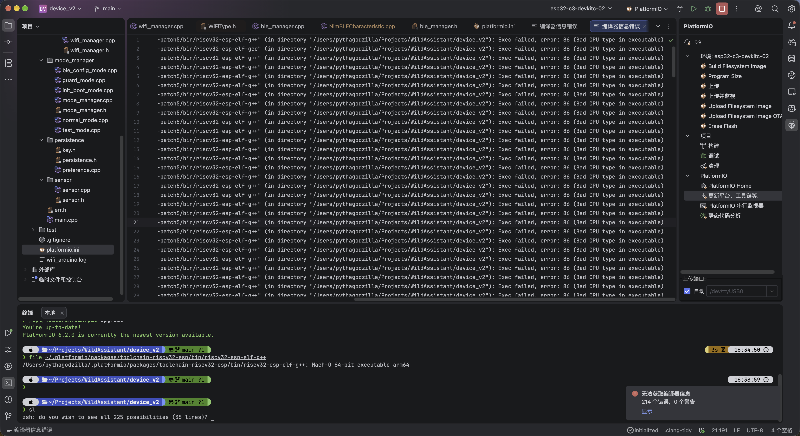
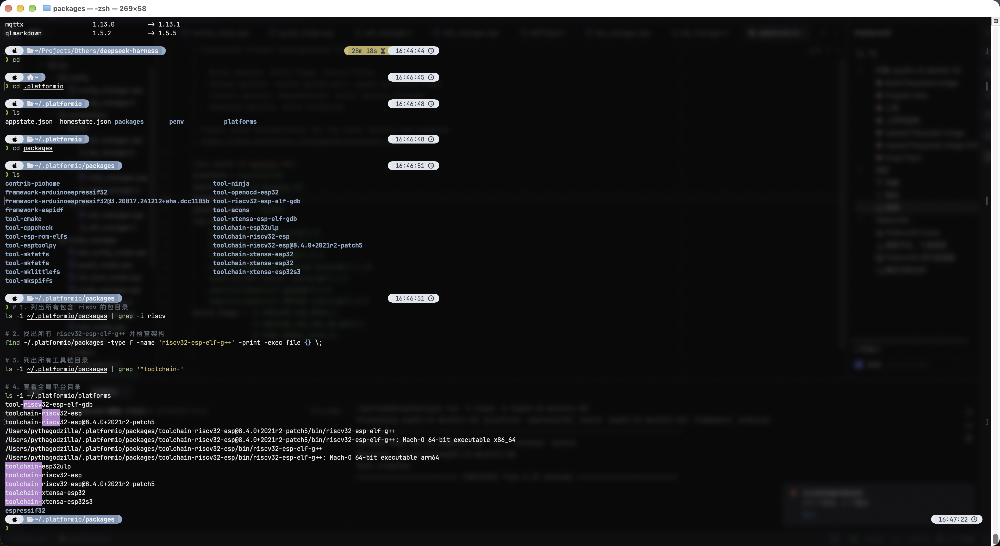

# MacOS 27肘飞了我的PlatformIO

> 省流： 换platformio.ini中的platform的源。

> 项目：Arduino + ESP32
> 
> IDE：Clion + PlatformIO
>
> 硬件：Mac Book Air M5

最近Apple终于推送了MacOS27，作为激进的保守派，也是第一时间更新了正式版MacOS27。当我惊叹于Apple似乎什么都没做的“细节“设计的时候，我的Clion&PlatformIO给我了一个suppress。

我像往常一样打开我的Clion中的项目准备进行一些更改。IDE突然报错`无法获取编译器信息 214个错误`。

wow！

214个错误，点开看看吧



amazing!

全都是`Cannot run program.....`，好嘛，往后翻翻



虽然我不是拉马努金，但是我们**注意到**：
每个报错的后面都有`bad cpu type`。也就是说我们要执行的文件和我们的cpu架构不匹配。

这个时候我们结合一下MacOS的更新说明，MacOS27的最大更新是什么呢？

MacOS27 是最后一个完整提供 `Rosetta`的系统，但是你以为是最后一个版本吗，大错特错了，Apple直接把对`Rosetta`的支持给默认取消了。而我通过pio下载的编译链是x86_64版本的，所以现在没有了`Rosetta`，自然无法运行“Intel CPU”的编译链了。

首先我来展示一下原来的`platformio.ini`:

```ini
[env:esp32-c3-devkitc-02]
platform = espressif32
board = esp32-c3-devkitc-02
framework = arduino
monitor_speed = 115200
lib_deps =
    knolleary/PubSubClient@^2.8
    bblanchon/ArduinoJson@^7.2.2
    h2zero/NimBLE-Arduino@^2.0.0
    adafruit/Adafruit Unified Sensor@^1.1.15
    adafruit/DHT sensor library@^1.4.7
    adafruit/Adafruit AHTX0@^2.0.6
    adafruit/Adafruit BMP280 Library@^3.0.0
build_flags = -D ARDUINO_USB_MODE=1
              -D ARDUINO_USB_CDC_ON_BOOT=1
              -D CORE_DEBUG_LEVEL=5
```

PlatformIO是根据这个platform来选择你的编译链的（大概这么说），因此呢我有



下面的几个命令是去列出每个编译链的架构。当然我们看到既有x86_64也有arm64的

我试过了几种方法尝试让pio自行切换到arm64的编译链未果。诸如：

1. 删除整个~/.platformio/packages以触发重新下载和选择编译链。
2. 删除项目下的.pio文件以重新索引

这时候有人问了，主播主播你直接固定platform_packages不行嘛？

好问题，但我不行，因为我的这个项目会放到Linux Windows和Mac上做，所以我不能写死编译链的架构，必须让pio自行选择。

最后最后，还是使用社区维护的pioarduino来管理，乐芯👎。目前用下来没什么毛病，推荐。

切换方法：

将`platformio.ini`的platform一行中的espressif32改为

```https://github.com/pioarduino/platform-espressif32/releases/download/stable/platform-espressif32.zip```

完整文件如下

```ini
[env:esp32-c3-devkitc-02]
platform = https://github.com/pioarduino/platform-espressif32/releases/download/stable/platform-espressif32.zip
board = esp32-c3-devkitc-02
framework = arduino
monitor_speed = 115200
……
```